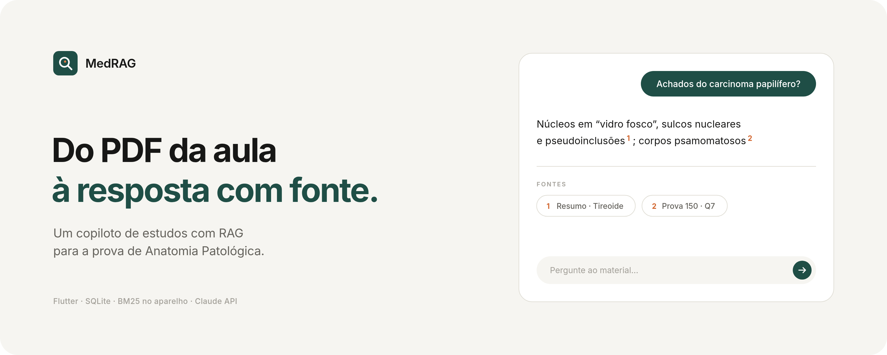
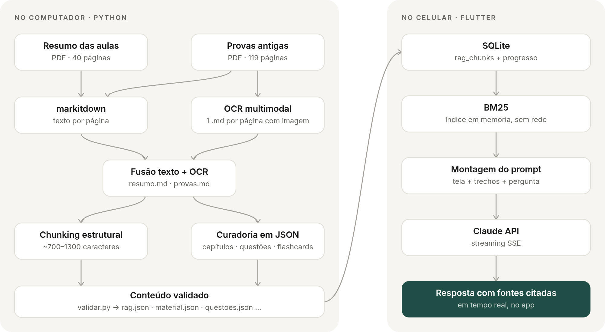
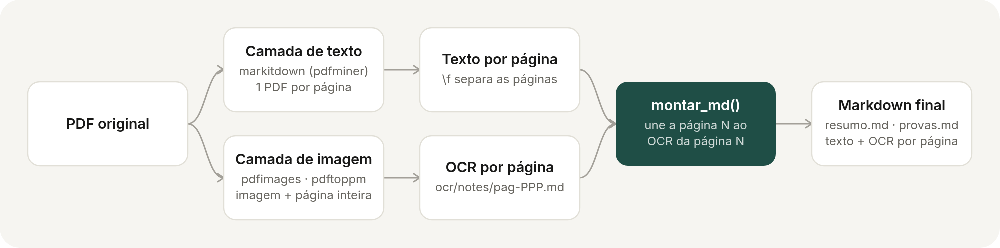
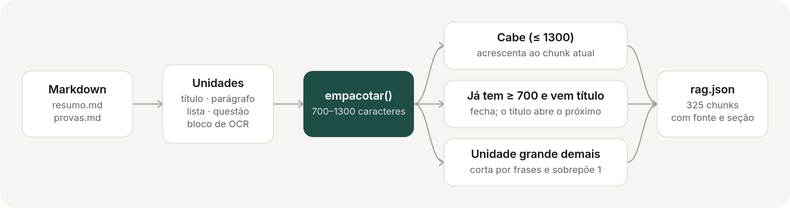
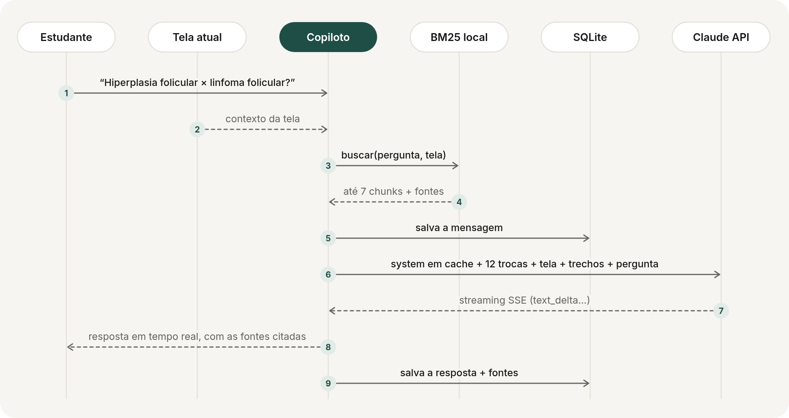

<p align="center">
  <picture>
    <source media="(prefers-color-scheme: dark)" srcset="docs/img/cover-dark.png">
    
  </picture>
</p>

<p align="center">
  <br>
  <b>MedRAG</b>: um copiloto de estudos com RAG para uma prova de Anatomia Patológica<br>
  <sub>Flutter · SQLite · BM25 no aparelho · Claude API · markitdown · OCR multimodal</sub>
</p>

---

## A história

Minha namorada estava se preparando para a P2 de **Anatomia Patológica II** do curso de medicina
(tireoide, linfadenopatias reacionais e linfomas). Ela já tinha estudado, mas o material estava espalhado:
um **resumo das aulas em PDF** (40 páginas) e um **compilado de provas antigas** (119 páginas) que mistura
texto digitado, **fotos de provas**, prints de formulários, gabaritos de origens diferentes (oficial, de aluno,
"do chat") e **anotações à mão**. Faltavam poucas horas, e ela precisava organizar tudo isso, não ler mais.

Aproveitei a situação para ajudá-la e para estudar, na prática, como se constrói um sistema de
**RAG (Retrieval-Augmented Generation)** de ponta a ponta:

1. **Ingestão**: transformar PDFs e imagens em Markdown limpo, com *markitdown* para o texto e OCR para as imagens.
2. **Indexação**: quebrar esse Markdown em *chunks* que fazem sentido sozinhos.
3. **Recuperação**: buscar os trechos certos para cada pergunta, no próprio celular e sem internet.
4. **Geração**: enviar a pergunta, os trechos e o contexto da tela ao Claude e mostrar a resposta com as fontes citadas.

Em volta do copiloto, o app virou uma plataforma de estudo completa: material em capítulos curtos,
141 questões de 16 provas antigas com correção, 259 flashcards com repetição espaçada, quadros comparativos,
figuras didáticas e um plano de estudo.

> [!NOTE]
> O conteúdo médico vem do material da disciplina e serve para estudar para uma prova. Não é orientação clínica.

---

## Visão geral da arquitetura

<p align="center">
  <picture>
    <source media="(prefers-color-scheme: dark)" srcset="docs/img/arquitetura-dark.png">
    
  </picture>
</p>

| Camada | Onde | Arquivos principais |
|---|---|---|
| Ingestão e empacotamento | `tools/` (Python) | [`build_content.py`](tools/build_content.py), [`validar.py`](tools/validar.py), [`svg2png.sh`](tools/svg2png.sh) |
| Fontes e conteúdo curado | `conteudo/` | `md/`, `ocr/`, `material/`, `questoes/`, `flashcards/`, `figuras/`, [`ESPECIFICACAO.md`](conteudo/ESPECIFICACAO.md) |
| Recuperação (R) | `app/lib/services/` | [`rag.dart`](app/lib/services/rag.dart) |
| Aumento + geração (A + G) | `app/lib/services/` | [`copilot.dart`](app/lib/services/copilot.dart), [`claude.dart`](app/lib/services/claude.dart) |
| Interface | `app/lib/ui/` | 5 abas: Início, Material, Questões, Flashcards, Mais |

---

## 1. Ingestão de dados: de PDF e foto para Markdown

Este foi o problema mais trabalhoso. Os dois PDFs têm naturezas bem diferentes:

| Fonte | O que tem dentro | Problema |
|---|---|---|
| **Resumo das aulas** (40 p.) | Texto digitado, títulos, listas, notas de rodapé, algumas imagens | O texto sai bem, mas é preciso saber **em que página** cada trecho está para juntar o OCR das imagens certas |
| **Provas antigas** (119 p.) | Texto digitado **e** fotos de provas, gabaritos fotografados, prints de formulário, marcações à mão | Boa parte da informação (a alternativa circulada, o "V" ou "F" escrito à mão, a correção do professor) **só existe na imagem** |

A solução foi tratar texto e imagem por caminhos separados e juntá-los página a página.

<p align="center">
  <picture>
    <source media="(prefers-color-scheme: dark)" srcset="docs/img/ingestao-dark.png">
    
  </picture>
</p>

### 1.1 Texto com markitdown

O [markitdown](https://github.com/microsoft/markitdown) (Microsoft) converte PDF, DOCX, PPTX e outros formatos
em Markdown pensado para LLMs. Ele foi usado em duas passagens:

- **Documento inteiro** → `conteudo/md/resumo_raw.md` e `notes_raw.md`: é o texto mais limpo e contínuo.
  No PDF das provas, o caractere `\f` (form feed) que o pdfminer emite entre páginas basta para cortar por página.
- **Página a página** (só no resumo): `pdfseparate` gera um PDF por página e o markitdown converte cada um,
  num único processo Python usando a API `MarkItDown().convert()`. O resultado fica em cache por hash do PDF.

Por que duas passagens? A conversão página a página às vezes quebra parágrafos e listas no meio, mas é a
única forma de saber onde cada página começa. Então `gerar_resumo_md()` **alinha** as duas versões: normaliza
os dois textos (NFKC, minúsculas, só alfanuméricos) e procura as primeiras ~30 letras de cada página
dentro do texto contínuo. Assim fica o texto limpo do documento inteiro, marcado com as páginas reais:

```text
resumo_raw.md (limpo, contínuo)     ──┐
                                      ├─► procura "otireoidecomecaa…" ─► corta no início da linha
pag-017.md (markitdown da página 17) ─┘                                   e marca <!-- página 17 -->
```

### 1.2 Imagens com OCR

O texto extraído não diz qual alternativa estava circulada na foto da prova. Para isso, cada página com imagem
passou por **OCR feito com um modelo multimodal (visão)**, que lê texto impresso e escrita à mão melhor
do que um OCR clássico em fotos tortas e com reflexo. Foram extraídas 53 imagens do PDF das provas
(`pdfimages`) e renderizadas 54 páginas inteiras (`pdftoppm`), porque a anotação à mão às vezes fica fora da
imagem embutida. O resultado são 54 páginas transcritas das provas e 7 do resumo.

A saída segue um **modelo fixo** (definido em [`ESPECIFICACAO.md` §3](conteudo/ESPECIFICACAO.md)) para que o
OCR seja útil tanto para busca quanto para conferência:

```markdown
## Página PPP — <foto de prova | foto de gabarito | captura de formulário | anotações manuscritas | ilustração>
**Descrição:** 1–3 frases: qual prova, estado da folha, o que está marcado.
**Transcrição (OCR):**
<texto impresso, fiel; trechos ilegíveis marcados como [ilegível]>
**Anotações manuscritas:**
<alternativas circuladas, V/F marcados, notas na margem, correções do professor; "nenhuma" se não houver>
```

Duas regras foram importantes:

- **Recortar e ampliar antes de desistir.** Se um trecho estiver ilegível, a imagem é recortada e ampliada
  com PIL e lida de novo.
- **Separar o impresso do manuscrito.** O que a aluna ou o professor escreveu à mão é a melhor pista do
  gabarito real, e ela entra na ordem de confiança das fontes:
  `oficial > foto (marcação visível) > aluno > NotebookLM > chat > inferido`.

### 1.3 Fusão e curadoria

`montar_md()` intercala, para cada página, o texto do markitdown e o bloco de OCR, gerando
[`conteudo/md/resumo.md`](conteudo/md/resumo.md) e [`conteudo/md/provas.md`](conteudo/md/provas.md).
Esses dois arquivos são a **fonte única** de tudo o que vem depois:

- viram os **chunks do RAG** (seção 2);
- serviram de base para a **curadoria estruturada** em JSON (capítulos do material, questões com gabarito e
  explicação, flashcards), seguindo o esquema e as regras de fidelidade de `ESPECIFICACAO.md`: não inventar
  fatos, marcar acréscimos como "Complemento:", registrar contradições em vez de corrigi-las sem avisar e
  preservar as ênfases do professor ("isso cai", "não cai", "pode zerar a questão");
- [`validar.py`](tools/validar.py) confere o esquema (tópicos de uma lista fechada, tipos de questão, campos
  obrigatórios, referências a figuras), e `build_content.py` **deduplica** questões repetidas entre provas
  (similaridade de Jaccard ≥ 0,82), usando a repetição como sinal de **frequência** do tema.

---

## 2. Construção do índice: chunking

Um bom RAG depende mais de **como o texto é cortado** do que do algoritmo de busca. Um chunk precisa
caber no prompt e fazer sentido sozinho. Por isso o corte de `empacotar()` respeita a estrutura do documento
em vez de contar caracteres às cegas:

<p align="center">
  <picture>
    <source media="(prefers-color-scheme: dark)" srcset="docs/img/chunking-dark.png">
    
  </picture>
</p>

Regras principais:

| Regra | Motivo |
|---|---|
| Alvo de **700–1300 caracteres** (mediana de 1137) | É grande o bastante para trazer o raciocínio inteiro e pequeno o bastante para mandar 7 chunks por pergunta |
| Corta **antes de títulos**, e um título no fim passa para o próximo chunk | O chunk começa pelo assunto, e o título ajuda na busca |
| **Sobreposição de 1 frase** quando a prosa é cortada | A ideia que atravessa o corte não se perde |
| Questões longas recebem o prefixo `[questão 4, continuação]` | O pedaço recuperado sozinho continua dizendo de onde veio |
| Chunks com menos de 250 caracteres se juntam ao anterior; restos com menos de 40 são descartados | Evita trechos inúteis como "Não tem foto da prova" |
| `fonte` e `seção` legíveis, como `Prova 150 (25.1) · questões 4–6` | Viram a **citação** que o modelo mostra na resposta |

Resultado: **325 chunks**, sendo 77 do resumo (Tireoide, Linfadenopatias, Linfomas) e 248 das provas antigas.

---

## 3. Funcionamento do RAG no app

### 3.1 Por que BM25, e não embeddings?

A recuperação roda **no celular, sem rede**, sobre os chunks guardados no SQLite. Escolhi **BM25**
(busca lexical) em vez de busca vetorial porque:

- **O vocabulário é técnico e exato.** `CD20`, `bcl-2`, `Reed-Sternberg`, `Hürthle`, `psamoma`. Nesse domínio,
  acertar o termo exato vale mais do que a semelhança semântica, e embeddings genéricos se confundem com siglas.
- **O corpus é pequeno** (325 chunks): o índice é montado em memória em milissegundos.
- **Não depende de nada**: nenhum modelo de embedding, nenhuma chamada extra de API e nenhum banco vetorial.
  O único acesso à rede é a chamada ao Claude.

A tokenização ([`rag.dart`](app/lib/services/rag.dart)) foi ajustada para português médico:

```text
"Os folículos têm CD20+ e BCL-2?"
  → minúsculas e sem acento  → "os foliculos tem cd20+ e bcl-2?"
  → normaliza siglas         → cd20+ → cd20 · bcl-2 → bcl2
  → remove stopwords PT      → (os, tem, e …)
  → radical leve             → foliculos → folicul · linfomas → linfom
  = [folicul, cd20, bcl2]
```

E o título da seção entra **duas vezes** no texto indexado, para pesar mais.

### 3.2 Pontuação

Para cada termo *t* da consulta e cada chunk *d*:

$$
\text{score}(d) = \sum_{t} w_t \cdot \text{idf}(t) \cdot \frac{f_{t,d}\,(k_1+1)}{f_{t,d} + k_1\left(1 - b + b\,\frac{|d|}{\overline{|d|}}\right)}
\qquad k_1 = 1{,}4 \quad b = 0{,}72
$$

- `idf` premia termos raros ("psamoma" vale mais que "tireoide").
- `b` penaliza chunks longos, para que um chunk não ganhe só por ter mais palavras.
- **`w_t` é o truque de contexto:** termos da pergunta valem **1,0**, e termos do que está **aberto na tela**
  (título do capítulo + primeiros 400 caracteres) valem **0,35**. Assim, uma pergunta vaga como
  *"explica isso de outro jeito"* ainda recupera o assunto certo.
- Ficam os **top 7**, desde que tenham pelo menos **28% da nota do primeiro**, para cortar ruído quando só um ou dois trechos são relevantes.

### 3.3 Do clique à resposta

<p align="center">
  <picture>
    <source media="(prefers-color-scheme: dark)" srcset="docs/img/sequencia-dark.png">
    
  </picture>
</p>

O prompt de cada turno separa as partes com tags XML:

```xml
<contexto_da_tela onde="Linfadenopatias › Padrão folicular">
  …texto que ela está vendo (até 7000 caracteres)…
</contexto_da_tela>

<trechos_recuperados>
[Resumo · Linfadenopatias — HIPERPLASIA FOLICULAR]
…chunk…
---
[Prova 148 (24.1) · questões 3–5]
…chunk…
</trechos_recuperados>

<pergunta>
Qual a diferença entre hiperplasia folicular e linfoma folicular?
</pergunta>
```

Decisões de projeto que fizeram diferença:

- **Os trechos vão só no turno atual.** O histórico leva apenas o texto das últimas 12 trocas, então o prompt
  não cresce sem limite e a busca é refeita a cada pergunta.
- **O *system prompt* fica em cache** (`cache_control: ephemeral`), porque ele é longo e igual em todas as chamadas.
- **Hierarquia de fontes no próprio prompt**: o gabarito oficial e o resumo valem mais que o gabarito "do chat";
  quando a resposta não está nos trechos, o modelo diz isso e marca o resto como "Complemento".
- **Regras do professor** viram instruções: diagnóstico completo ("Linfoma de Hodgkin clássico, tipo esclerose
  nodular"), nada de diagnóstico de linfoma sem imuno-histoquímica, citar marcadores com + e −.
- **Modos de uso**: ela pode pedir para ser testada (uma pergunta por vez, com correção) ou para corrigir uma
  resposta discursiva contra a resposta-modelo e o checklist da questão.
- **Cliente HTTP próprio em Dart** ([`claude.dart`](app/lib/services/claude.dart)) com streaming por SSE,
  mensagens de erro em português (chave recusada, limite atingido, serviço sobrecarregado, sem internet) e
  *fallback* do lado do servidor caso um classificador recuse um conteúdo biomédico por engano.

---

## 4. O app

| Aba | O que faz |
|---|---|
| **Início** | Plano de estudo, progresso por módulo, o que revisar agora |
| **Material** | 18 capítulos curtos com destaques, anotações por trecho, 16 figuras didáticas (SVG próprios), 23 micrografias com crédito e quadros comparativos |
| **Questões** | 141 questões de 16 provas: múltipla escolha, V/F com justificativa, discursivas com resposta-modelo e checklist, lacunas; simulado e mapa de desempenho por tópico |
| **Flashcards** | 259 cartões com repetição espaçada |
| **Mais** | Configurações (nome, **chave da API**, tema, tamanho do texto), créditos |
| **Copiloto** | Botão flutuante em todas as telas, que sabe o que está aberto |

Tudo o que ela produz (anotações, respostas, tentativas, estado dos flashcards, conversa) fica no **SQLite
local**. O app funciona offline, e só o copiloto precisa de internet.

---

## Como rodar

### Pré-requisitos

- Flutter **3.50+** / Dart **3.14+**
- Uma chave da API da Anthropic, criada em [console.anthropic.com](https://console.anthropic.com/) › *API Keys*
- Para regerar o conteúdo (opcional): Python 3, `pip install pillow`, `uv tool install markitdown` (ou `pipx install markitdown`) e `poppler-utils` (`pdfseparate`, `pdfinfo`, `pdfimages`, `pdftoppm`)

### App

```bash
cd app
flutter pub get
flutter run              # Android (emulador ou aparelho)
flutter run -d chrome    # web
```

Na primeira abertura, o app pede **seu nome** e, opcionalmente, **sua chave da API**. Também dá para colar ou
trocar a chave depois em **Mais › Configurações**, que tem um botão *Testar copiloto*.

> [!IMPORTANT]
> **Nenhuma chave vai embutida no app.** Cada pessoa usa a própria chave, que fica salva só no SQLite do aparelho
> e é enviada apenas para `api.anthropic.com`. No Flutter web, a chamada sai direto do navegador
> (`anthropic-dangerous-direct-browser-access`). Isso funciona para uso pessoal, mas, se o app for publicado para
> outras pessoas, o ideal é ter um backend intermediário.

### Pipeline de conteúdo

> [!NOTE]
> Os PDFs originais e as fotos de provas são material de terceiros e **não estão no repositório**. Os arquivos
> derivados estão: o Markdown do markitdown (`conteudo/md/*_raw.md`), o OCR de cada página (`conteudo/ocr/`) e o
> conteúdo curado em JSON. Por isso, o build e o app funcionam sem eles. Sem o PDF do resumo, o build só avisa que
> não consegue refazer a marcação de páginas.

```bash
python3 tools/validar.py               # valida os JSON de conteudo/
python3 tools/build_content.py         # gera resumo.md, provas.md e app/assets/content/*.json
python3 tools/build_content.py --forcar  # segue mesmo com avisos de esquema
```

O build é **idempotente**: sem mudanças na origem, ele gera exatamente os mesmos arquivos.

---

## Estrutura

```text
MedRAG/
├── app/                       # Flutter (Android + web)
│   ├── lib/
│   │   ├── services/          # rag.dart (BM25) · copilot.dart (prompt) · claude.dart (API/SSE)
│   │   ├── data/              # SQLite, modelos, estado global
│   │   └── ui/                # telas: home, material, questions, flashcards, more, copilot
│   ├── assets/                # conteúdo empacotado, figuras, fotos, fontes, ícone
│   └── ARQUITETURA.md         # guia de convenções do código
├── conteudo/
│   ├── md/                    # *_raw.md (markitdown) → resumo.md / provas.md (+ OCR)
│   ├── ocr/                   # transcrição de cada página com imagem
│   ├── material/ questoes/ flashcards/   # conteúdo curado (JSON)
│   ├── figuras/ fotos/        # ilustrações SVG/PNG e micrografias com crédito
│   └── ESPECIFICACAO.md       # esquema do conteúdo + regras de fidelidade e de OCR
├── tools/                     # build_content.py · validar.py · gerar_arte.py · svg2png.sh · shot.sh
└── docs/img/                  # capa, ícone e diagramas deste README (claro e escuro)
```

---

## O que eu aprendi

- **A ingestão é a maior parte do trabalho.** O modelo só responde bem se o texto que chega até ele estiver
  limpo, com a página certa e com o que está escrito à mão. markitdown resolve o texto, mas foto de prova pede OCR
  com visão e um formato de saída rígido.
- **Chunking com estrutura vale mais que algoritmo sofisticado.** Respeitar títulos, questões e frases, e dar a
  cada chunk uma fonte legível, melhorou mais a recuperação do que qualquer ajuste de parâmetro.
- **BM25 é um ótimo começo em domínios técnicos e corpora pequenos**: é simples, explicável, offline e bom com
  siglas. O próximo passo natural seria uma busca **híbrida** (BM25 + embeddings) com *re-ranking*.
- **O contexto da tela é um sinal barato e forte.** Juntar o que a pessoa está vendo à consulta, com peso menor,
  resolve perguntas vagas sem pedir que ela reescreva.
- **Citar a fonte gera confiança**, principalmente quando há gabaritos conflitantes.

## Créditos

- Resumo das aulas e provas antigas: material de estudo da turma, usado apenas para fins educacionais.
- Micrografias: créditos e licenças de cada imagem em `conteudo/fotos/manifest.json` e na tela *Sobre* do app.
- Fontes: [Inter](https://rsms.me/inter/) e [DM Serif Display](https://fonts.google.com/specimen/DM+Serif+Display) (OFL).
